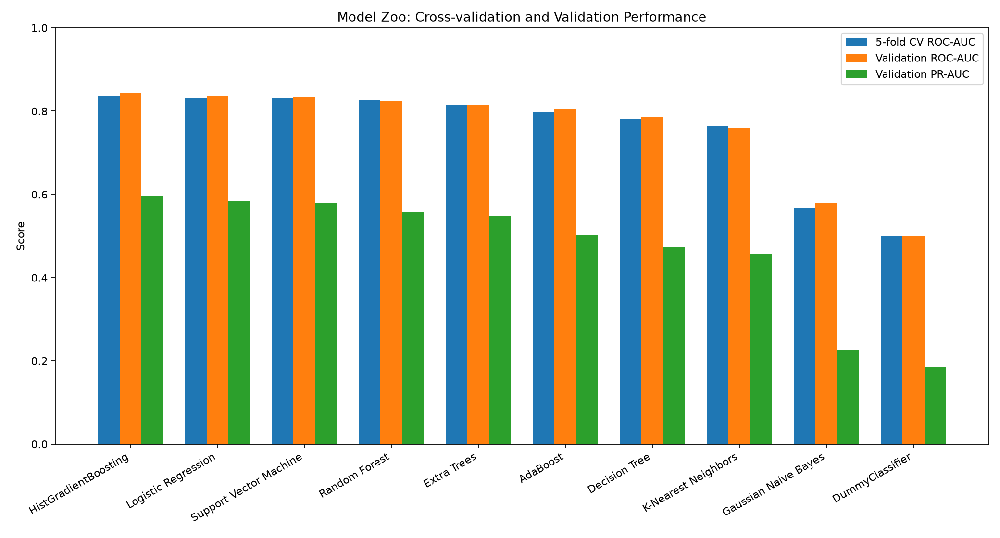

# Phase 2E — Ten-model comparison

## Protocol

Used labeled `loan_train.csv` only. After Phase 2 cleaning, an 80/20 stratified split (`random_state=42`) yielded 10 requested model attempts with validation rows reserved for evaluation. Each model's entire imputation, scaling, and one-hot encoding pipeline was refit inside each of five `StratifiedKFold` folds on the training partition. Primary model-zoo ranking is five-fold ROC-AUC mean; the validation split is reported separately. Positive label is default (`1`). No hold-out test labels or scenario labels were used.

The model zoo includes DummyClassifier, Logistic Regression, KNN, Gaussian Naive Bayes, Decision Tree, Random Forest, Extra Trees, HistGradientBoosting, AdaBoost, and a calibrated linear SVM. For SVM, `LinearSVC` is probability-calibrated within the training pipeline to support evaluation and downstream probability thresholds.

## Consolidated comparison

| Model                  | Validation Accuracy | Validation Precision | Validation Recall | Validation F1 | Validation ROC-AUC | Validation PR-AUC | CV ROC_AUC Mean | CV ROC_AUC Std | CV PRECISION Mean | CV PRECISION Std | CV RECALL Mean | CV RECALL Std | CV F1 Mean | CV F1 Std | CV Fit Seconds Mean | Validation Business Cost |
| ---------------------- | ------------------- | -------------------- | ----------------- | ------------- | ------------------ | ----------------- | --------------- | -------------- | ----------------- | ---------------- | -------------- | ------------- | ---------- | --------- | ------------------- | ------------------------ |
| HistGradientBoosting   | 0.8529              | 0.7020               | 0.3656            | 0.4808        | 0.8429             | 0.5946            | 0.8374          | 0.0072         | 0.7035            | 0.0226           | 0.3359         | 0.0178        | 0.4547     | 0.0205    | 3.4260              | 77545000.0000            |
| Logistic Regression    | 0.8425              | 0.6327               | 0.3681            | 0.4654        | 0.8376             | 0.5851            | 0.8330          | 0.0099         | 0.6685            | 0.0167           | 0.3743         | 0.0138        | 0.4798     | 0.0141    | 0.5729              | 78280000.0000            |
| Support Vector Machine | 0.8438              | 0.6542               | 0.3418            | 0.4490        | 0.8354             | 0.5791            | 0.8313          | 0.0095         | 0.6955            | 0.0201           | 0.3247         | 0.0160        | 0.4426     | 0.0173    | 1.3381              | 80795000.0000            |
| Random Forest          | 0.8240              | 0.8652               | 0.0653            | 0.1215        | 0.8239             | 0.5579            | 0.8261          | 0.0067         | 0.9051            | 0.0506           | 0.0407         | 0.0065        | 0.0778     | 0.0120    | 2.2673              | 110380000.0000           |
| Extra Trees            | 0.8141              | 1.0000               | 0.0017            | 0.0034        | 0.8157             | 0.5473            | 0.8149          | 0.0105         | 0.2000            | 0.4000           | 0.0002         | 0.0004        | 0.0004     | 0.0008    | 2.1062              | 117700000.0000           |
| AdaBoost               | 0.8269              | 0.6781               | 0.1340            | 0.2238        | 0.8062             | 0.5013            | 0.7986          | 0.0094         | 0.7617            | 0.0298           | 0.1412         | 0.0131        | 0.2378     | 0.0180    | 2.6618              | 103225000.0000           |
| Decision Tree          | 0.8246              | 0.5452               | 0.3528            | 0.4284        | 0.7864             | 0.4729            | 0.7826          | 0.0024         | 0.5907            | 0.0137           | 0.3186         | 0.0210        | 0.4137     | 0.0203    | 0.7852              | 81505000.0000            |
| K-Nearest Neighbors    | 0.8278              | 0.6802               | 0.1425            | 0.2356        | 0.7602             | 0.4561            | 0.7646          | 0.0116         | 0.7207            | 0.0228           | 0.1446         | 0.0026        | 0.2408     | 0.0043    | 0.1763              | 102285000.0000           |
| Gaussian Naive Bayes   | 0.5444              | 0.2251               | 0.5920            | 0.3262        | 0.5784             | 0.2252            | 0.5677          | 0.0074         | 0.2143            | 0.0047           | 0.5824         | 0.0230        | 0.3133     | 0.0080    | 0.3322              | 84145000.0000            |
| DummyClassifier        | 0.8137              | 0.0000               | 0.0000            | 0.0000        | 0.5000             | 0.1863            | 0.5000          | 0.0000         | 0.0000            | 0.0000           | 0.0000         | 0.0000        | 0.0000     | 0.0000    | 0.1804              | 117900000.0000           |

## Required model execution status

Completed models: HistGradientBoosting, Logistic Regression, Support Vector Machine, Random Forest, Extra Trees, AdaBoost, Decision Tree, K-Nearest Neighbors, Gaussian Naive Bayes, DummyClassifier.

Failures (exact error included; no silent skip):

All 10 requested models completed successfully; no model was skipped.

No model is declared production-ready based on this single split. The CV standard deviations show fold-to-fold variability on this training sample; time-aware validation, calibration, and fairness review remain necessary.
