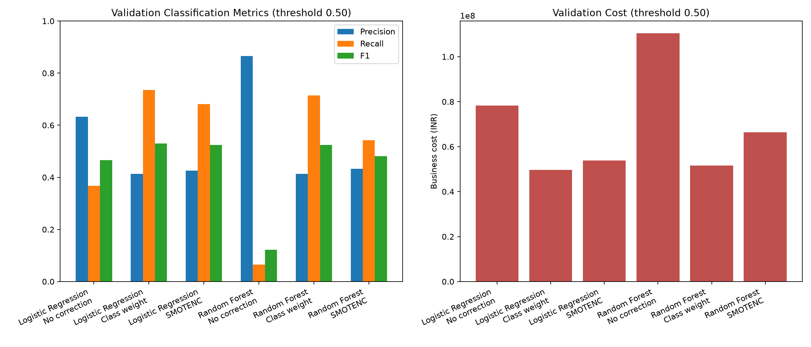

# Phase 2F — Imbalance strategy comparison

SMOTENC is placed inside an imbalanced-learn pipeline, after fold-fitted numeric imputation/scaling and categorical ordinal encoding, but before one-hot encoding and classification. Thus the sampler is fitted only on each cross-validation training fold; validation samples are neither resampled nor used to fit preprocessing. Class weighting is fitted within each training fold. The validation set is held out from every sampler and estimator fit.

## Validation comparison at threshold 0.50

| Strategy      | Model               | Validation Precision | Validation Recall | Validation F1 | Validation ROC-AUC | Validation PR-AUC | Validation False Negatives | Validation False Positives | Validation Business Cost | Validation Cost per Applicant | CV ROC_AUC Mean | CV ROC_AUC Std |
| ------------- | ------------------- | -------------------- | ----------------- | ------------- | ------------------ | ----------------- | -------------------------- | -------------------------- | ------------------------ | ----------------------------- | --------------- | -------------- |
| No correction | Logistic Regression | 0.6327               | 0.3681            | 0.4654        | 0.8376             | 0.5851            | 745.0000                   | 252.0000                   | 78280000.0000            | 12366.5087                    | 0.8330          | 0.0099         |
| Class weight  | Logistic Regression | 0.4140               | 0.7354            | 0.5298        | 0.8363             | 0.5785            | 312.0000                   | 1227.0000                  | 49605000.0000            | 7836.4929                     | 0.8310          | 0.0094         |
| SMOTENC       | Logistic Regression | 0.4255               | 0.6811            | 0.5238        | 0.8182             | 0.5508            | 376.0000                   | 1084.0000                  | 53860000.0000            | 8508.6888                     | 0.8094          | 0.0102         |
| No correction | Random Forest       | 0.8652               | 0.0653            | 0.1215        | 0.8239             | 0.5579            | 1102.0000                  | 12.0000                    | 110380000.0000           | 17437.5987                    | 0.8261          | 0.0067         |
| Class weight  | Random Forest       | 0.4132               | 0.7150            | 0.5238        | 0.8235             | 0.5377            | 336.0000                   | 1197.0000                  | 51555000.0000            | 8144.5498                     | 0.8238          | 0.0089         |
| SMOTENC       | Random Forest       | 0.4330               | 0.5428            | 0.4817        | 0.7979             | 0.4732            | 539.0000                   | 838.0000                   | 66470000.0000            | 10500.7899                    | 0.7915          | 0.0101         |

## Observed changes relative to no correction

- **Logistic Regression, Class weight:** recall 0.3681 → 0.7354; precision 0.6327 → 0.4140; false positives 252 → 1,227; business cost INR 78,280,000 → INR 49,605,000.
- **Logistic Regression, SMOTENC:** recall 0.3681 → 0.6811; precision 0.6327 → 0.4255; false positives 252 → 1,084; business cost INR 78,280,000 → INR 53,860,000.
- **Random Forest, Class weight:** recall 0.0653 → 0.7150; precision 0.8652 → 0.4132; false positives 12 → 1,197; business cost INR 110,380,000 → INR 51,555,000.
- **Random Forest, SMOTENC:** recall 0.0653 → 0.5428; precision 0.8652 → 0.4330; false positives 12 → 838; business cost INR 110,380,000 → INR 66,470,000.

Best observed threshold-0.50 trade-off by validation business cost: **Logistic Regression with Class weight**, cost INR 49,605,000 (FN 312, FP 1,227). This is a single validation split and is not a causal or production conclusion.

CV/fit failures: None.

