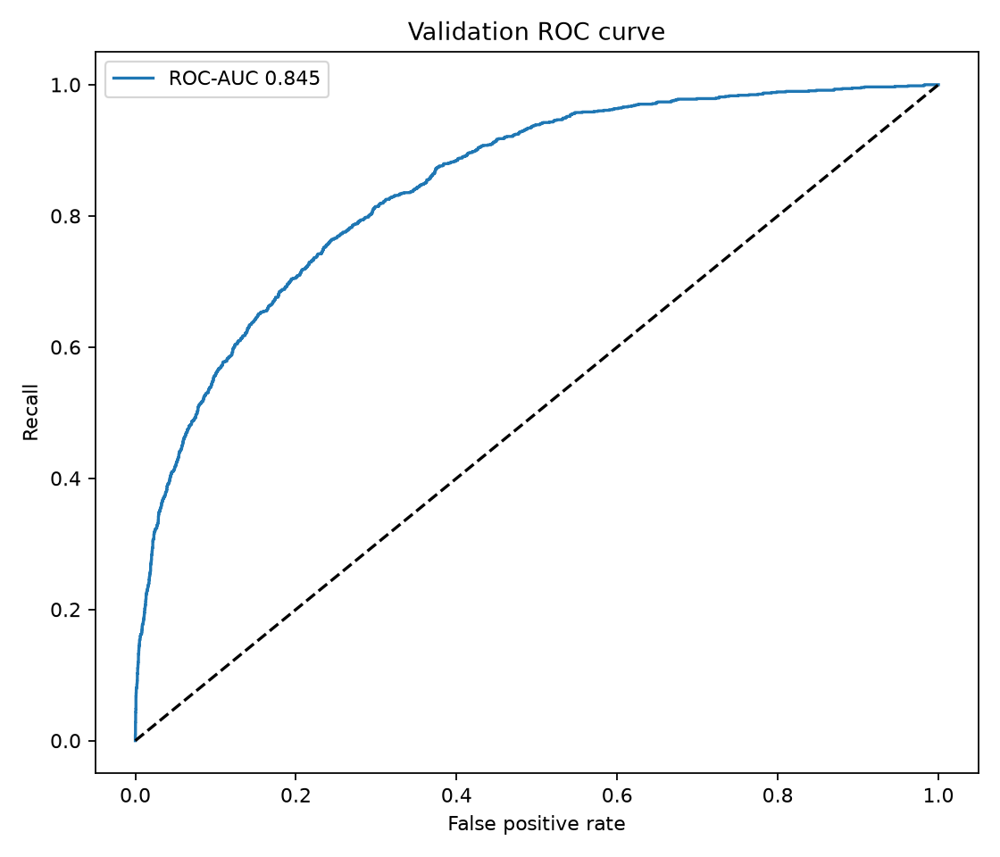
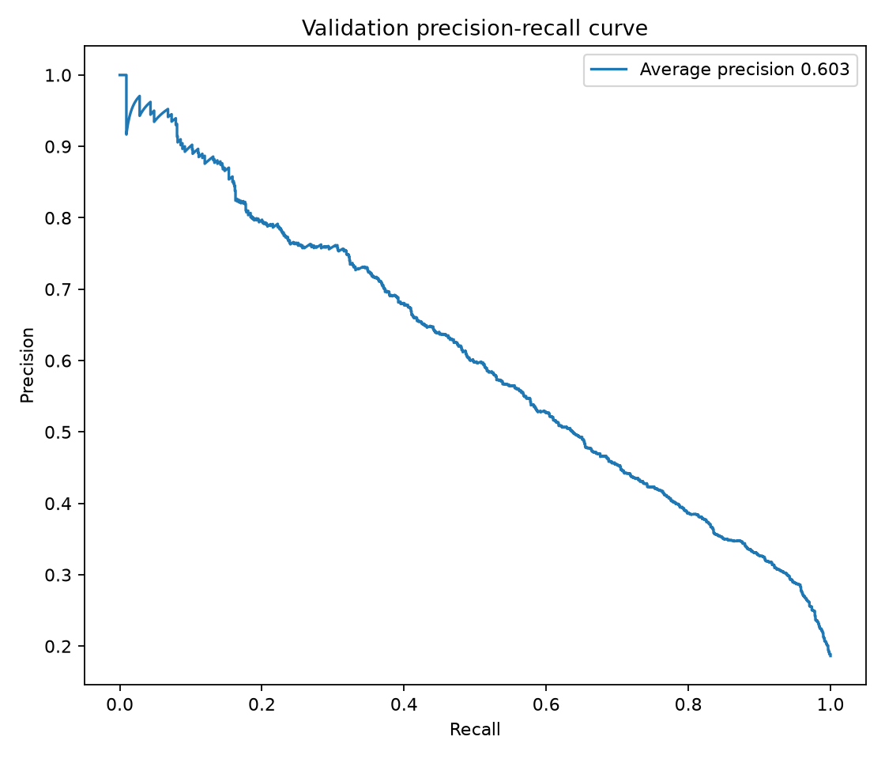
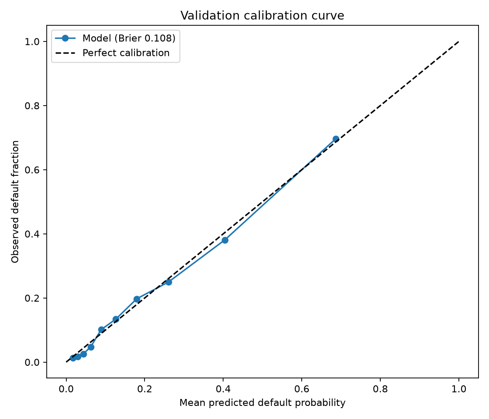
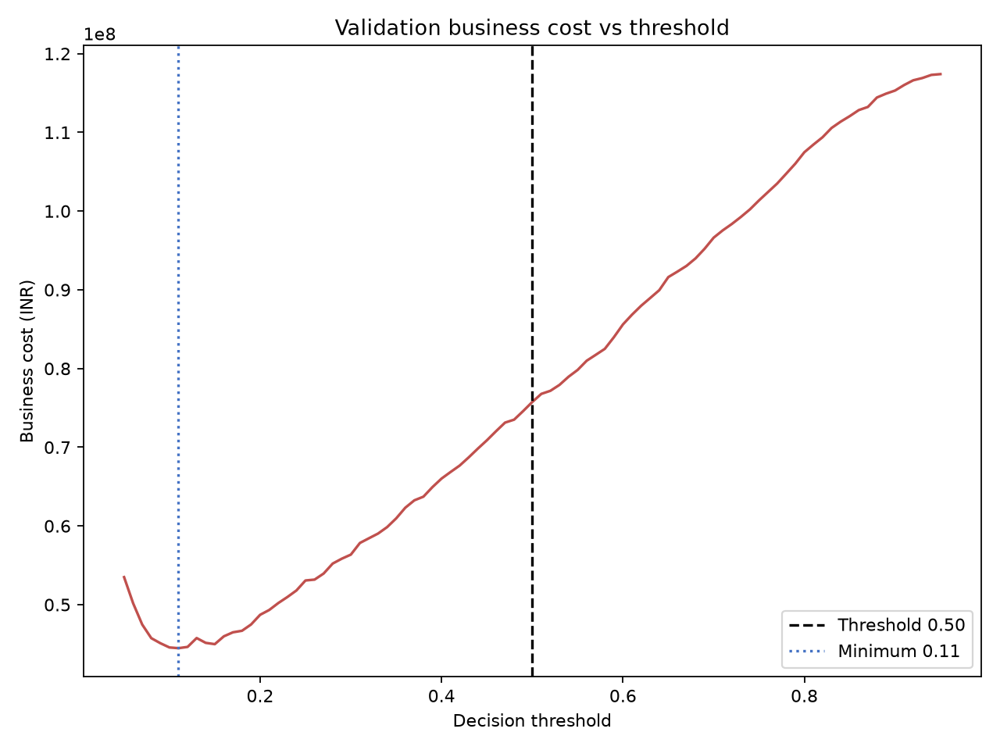

# Phase 2H — Validation threshold and business-cost analysis

Selected candidate: **HistGradientBoosting**. Validation probabilities came from a model fitted only on the training split. The validation labels were not used to fit preprocessing, estimator, or probability calibrator; they were used only to evaluate thresholds and costs.

- ROC-AUC: 0.8452
- PR-AUC / average precision: 0.6035
- Brier score: 0.1080 (lower is better; this does not establish adequate calibration)
- Threshold with minimum observed validation cost: **0.11**
- Cost at threshold 0.50: INR 75,745,000
- Cost at optimized threshold: INR 44,475,000
- Validation cost improvement: INR 31,270,000 (41.28%)
- At 0.50: FN 727, FP 203, recall 0.3834, precision 0.6901
- At selected threshold: FN 138, FP 2,045, recall 0.8830, precision 0.3373, cost/applicant INR 7026.07

For decisions, a default prediction means the application is flagged for rejection/review under this binary rule; a non-default prediction means it is flagged for approval. A lower threshold generally flags more applications as default, reducing false approvals at the possible cost of more false rejections. This model threshold is selected empirically for the stated costs on one validation split; it is not automatically an approved lending policy.

All thresholds from 0.05 to 0.95 in increments of 0.01, including 0.50, are in `threshold_analysis.csv`. Cost is `FN × INR 100,000 + FP × INR 15,000`.

The calibration curve is a validation reliability diagnostic only. No calibration model was fitted using validation labels. Threshold selection and model selection on this same validation set may be optimistic; use an additional untouched policy/calibration set or nested evaluation before deployment.

