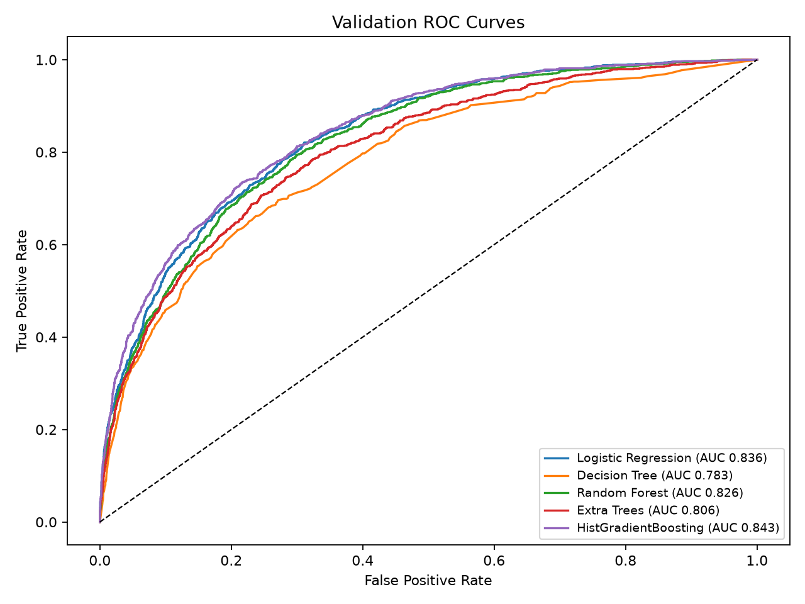
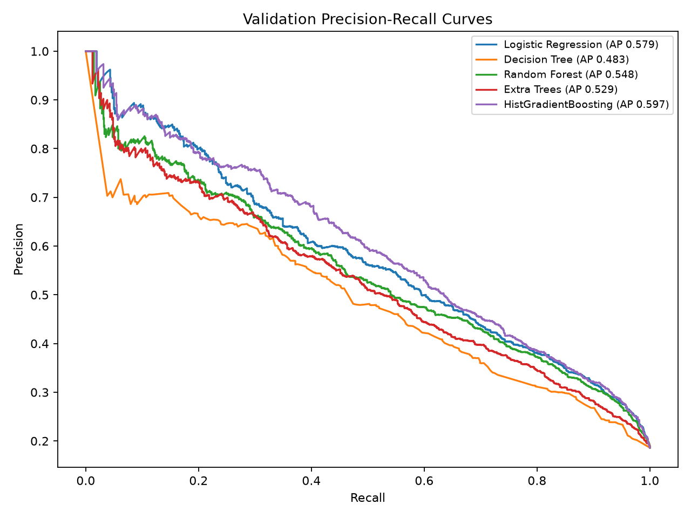
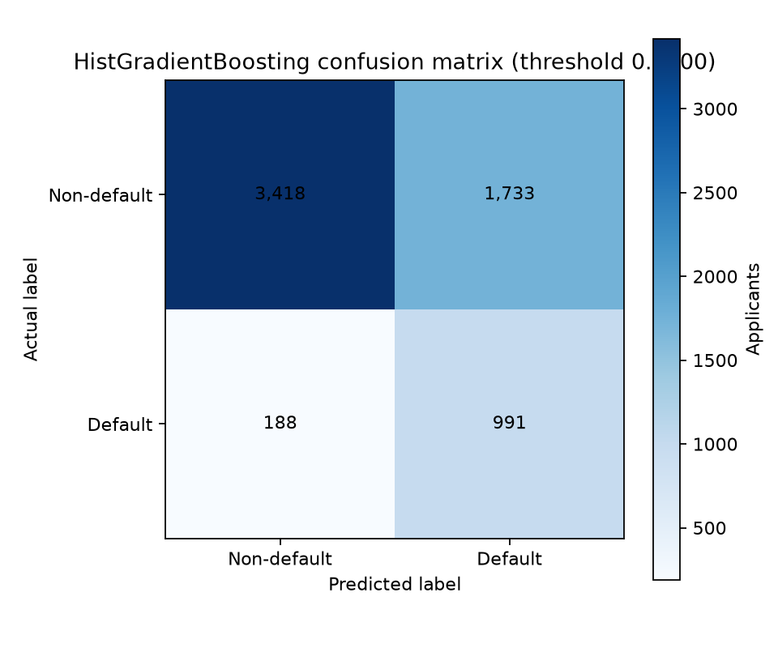
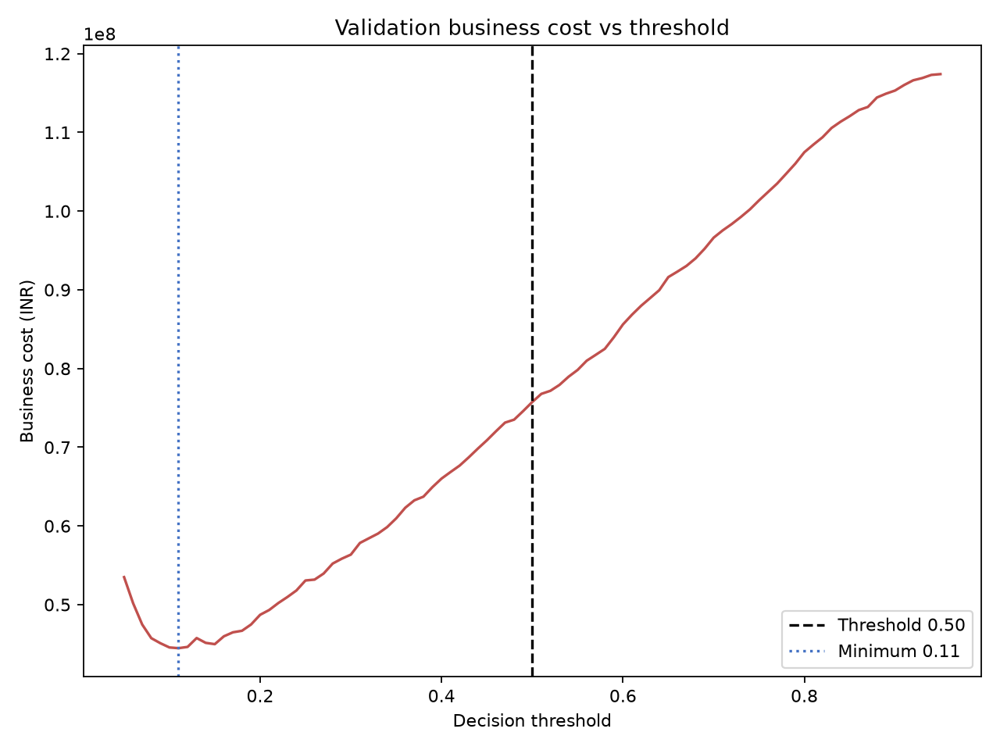
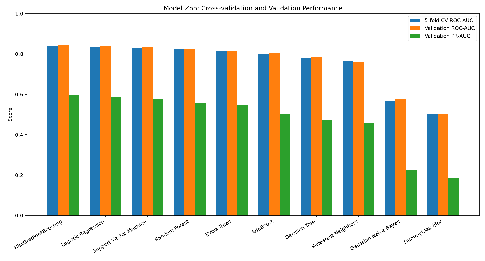

# FinTrust Loan Default Prediction — Phase 3 Evaluation

## Scope and reproducibility

This evaluation uses only labeled records from `loan_train.csv`. The original training file has 32,600 rows; Phase 2 cleaning removes exact duplicates and unlabeled records, leaving 31,650 labeled records. An 80/20 stratified split with `random_state=42` produced 25,320 model-training rows and 6,330 validation rows. The validation partition was not used for fitting any imputer, encoder, scaler, or classifier. The hold-out `loan_test.csv` and scenario cases were not loaded or used by the Phase 3 training workflow.

Preprocessing reuses `src/features.py` and is fitted inside each sklearn pipeline on the training partition only. Phase 2 target/leakage exclusions remain in effect. Positive class `1` means default. Each threshold is evaluated on the same held-out validation probabilities; the model selection and threshold results are therefore validation estimates and must not be interpreted as production performance.

Runtime details: split 0.19s; total Phase 3 run 73.09s. Per-model timing (three-fold cross-validation plus final training-partition fit):

| Model                | CV Seconds | Fit Seconds | Total Model Seconds |
| -------------------- | ---------- | ----------- | ------------------- |
| HistGradientBoosting | 13.76      | 6.03        | 19.78               |
| Logistic Regression  | 1.51       | 0.62        | 2.13                |
| Random Forest        | 7.70       | 3.99        | 11.69               |
| Extra Trees          | 6.60       | 4.04        | 10.64               |
| Decision Tree        | 2.79       | 1.38        | 4.17                |

False-negative cost = ₹100,000; false-positive cost = ₹15,000. Optional estimators not evaluated: XGBoost, LightGBM, and CatBoost (not installed; intentionally not installed).

## Model comparison

The table reports validation metrics at each model's threshold minimizing the specified validation cost. Selection prioritizes minimum validation business cost, then validation ROC-AUC, PR-AUC, recall, precision, lower three-fold ROC-AUC variability, and a smaller train-to-validation ROC-AUC gap.

| Model                | Threshold | Accuracy | Precision | Recall | F1     | ROC-AUC | PR-AUC | CV ROC-AUC Mean | CV ROC-AUC Std | CV PR-AUC Mean | CV PR-AUC Std | Specificity | False Negatives | False Positives | Business Cost | Cost per Applicant | CV Seconds | Fit Seconds | ROC-AUC Gap |
| -------------------- | --------- | -------- | --------- | ------ | ------ | ------- | ------ | --------------- | -------------- | -------------- | ------------- | ----------- | --------------- | --------------- | ------------- | ------------------ | ---------- | ----------- | ----------- |
| HistGradientBoosting | 0.4000    | 0.6965   | 0.3638    | 0.8405 | 0.5078 | 0.8434  | 0.5975 | 0.8382          | 0.0048         | 0.5931         | 0.0027        | 0.6636      | 188             | 1,733           | 44,795,000    | 7076.6193          | 13.76      | 6.03        | 0.0290      |
| Logistic Regression  | 0.3400    | 0.6545   | 0.3362    | 0.8770 | 0.4860 | 0.8363  | 0.5785 | 0.8292          | 0.0057         | 0.5827         | 0.0068        | 0.6036      | 145             | 2,042           | 45,130,000    | 7129.5419          | 1.51       | 0.62        | 0.0159      |
| Random Forest        | 0.3900    | 0.6425   | 0.3275    | 0.8728 | 0.4763 | 0.8258  | 0.5482 | 0.8244          | 0.0062         | 0.5525         | 0.0117        | 0.5898      | 150             | 2,113           | 46,695,000    | 7376.7773          | 7.70       | 3.99        | 0.0888      |
| Extra Trees          | 0.4700    | 0.6812   | 0.3461    | 0.7998 | 0.4831 | 0.8057  | 0.5294 | 0.8052          | 0.0041         | 0.5312         | 0.0141        | 0.6540      | 236             | 1,782           | 50,330,000    | 7951.0269          | 6.60       | 4.04        | 0.0820      |
| Decision Tree        | 0.2800    | 0.5962   | 0.2973    | 0.8567 | 0.4414 | 0.7827  | 0.4829 | 0.7743          | 0.0009         | 0.4721         | 0.0077        | 0.5366      | 169             | 2,387           | 52,705,000    | 8326.2243          | 2.79       | 1.38        | 0.0786      |

### Selected model and threshold

- **Selected model:** HistGradientBoosting
- **Optimal validation threshold:** 0.4000
- **Accuracy:** 0.6965
- **Precision:** 0.3638
- **Default recall:** 0.8405
- **F1:** 0.5078
- **ROC-AUC:** 0.8434
- **PR-AUC / average precision:** 0.5975
- **Specificity:** 0.6636
- **Validation business cost:** ₹44,795,000
- **Cost per validation applicant:** ₹7,076.62
- **False negatives / false approvals:** 188
- **False positives / false rejections:** 1,733
- **Predicted defaults / non-defaults:** 2,724 / 3,606
- **Default detection rate:** 0.8405

Confusion matrix, rows actual `[non-default, default]`, columns predicted `[non-default, default]`:

| | Predicted non-default | Predicted default |
|---|---:|---:|
| Actual non-default | 3,418 | 1,733 |
| Actual default | 188 | 991 |

At threshold 0.50, the selected model has 301 false negatives, 1,234 false positives, and validation cost ₹48,610,000. The tuned threshold is selected from a 0.01–0.99 grid, including exactly 0.50 and the cost-only break-even reference (0.1304); it is not assumed to be 0.50.

## Threshold analysis

`outputs/threshold_analysis.csv` contains the complete per-model sweep and the false-negative/false-positive counts, total cost, cost per applicant, recall, precision, specificity, predicted class counts, and default detection rate for each threshold. The total cost is `FN × ₹100,000 + FP × ₹15,000`. The mathematical break-even probability of 13.04% assumes well-calibrated probabilities and only these two costs; it is a reference point, not an operating-policy recommendation.

## Visualizations

## Limitations and recommendation

- A single random stratified split does not establish model stability. `ROC-AUC Gap` and `PR-AUC Gap` compare training with validation on this split only; use repeated or time-aware validation after label maturity and application chronology are confirmed.
- Three-fold stratified cross-validation is also run inside the training partition with the complete preprocessing pipeline refitted independently in each fold. Its ROC-AUC/PR-AUC means and standard deviations provide a training-only stability indicator, but do not replace repeated/time-aware validation or an independent test evaluation.
- Threshold optimization on the same validation partition used for model selection can be optimistic. A separate calibration/threshold-selection partition or nested/repeated validation is needed before policy use.
- Class-weighted estimators can produce probabilities that need calibration. Thresholds optimized here are tied to the fitted model and validation population; review calibration and cost sensitivity.
- The feature set retains the Phase 2 exclusions. Point-in-time availability of debt-to-income and branch-code policy/fairness risks remain open questions in the Phase 2 report.
- Validation metrics and costs do not establish production readiness. No test-set or scenario predictions were produced.

**Recommendation:** retain HistGradientBoosting as the Phase 3 validation candidate at threshold 0.4000, subject to calibration, repeated/time-aware validation, fairness review, and confirmation of feature timing and cost assumptions. Do not treat this single-split result as an approved production model.

